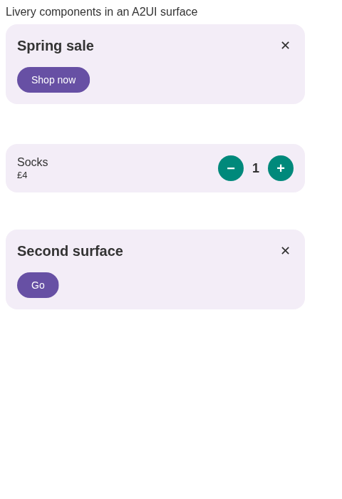
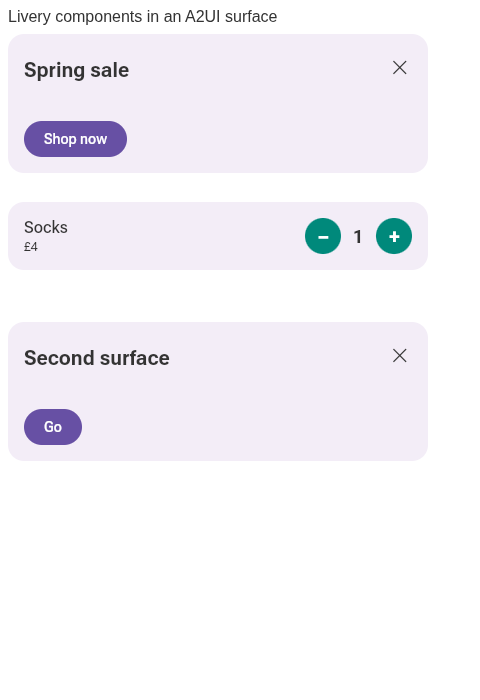
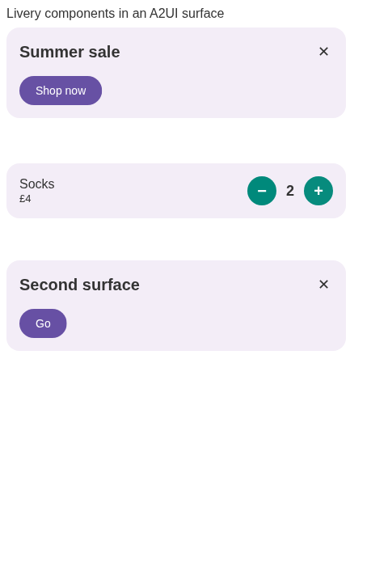

# In-page Compose Multiplatform for A2UI

`liveryCatalog(session, { catalogId, player: 'cmp' })` prepares the optional CMP renderer.
`'ts'` remains the default; a `(box, onAction) => LiveryPlayer` factory is the extension point.
Both mount directly in the component's own DOM. There is no iframe.

## Boundary and lifecycle

`livery-web` retains selection, trust, binding, instantiation, live render IDs and action policy.
The optional `livery-web-compose` module receives exactly the same admitted document and values
as the TS renderer. It calls rc-players' `RcComposePlayer` in a `ComposeViewport`. Its raw named
actions return through `LiveryElement` and `LiverySession.action`, to the original live plan's
`ActionGate`. No RenderPlan is rebuilt from bytes and there is no second gate or selector.

This differs from mounting `LiveryTemplate` against a shared live-plan map: the split module
cannot share Kotlin objects. Reusing the existing byte/value player boundary keeps the default
pipeline independent of Compose, and avoids duplicating LiveryTemplate's impression and action
routing. `session.shown` remains the one impression route, after the CMP draw completes.

The decoded document and state map survive updates. Only a changed `documentKey` decodes again;
images and `long` values already baked by the pipeline participate in that key. Named values
are converted according to the document's declarations, so a numeric float is not confused with
an integer and a string beginning with `#` is not mistaken for a colour. Superseded/removed shows
resolve false. A malformed or unsupported document rejects the show, allowing the element's
normal chosen-design → automatic-design fallback.

Each viewport owns a canvas, Skia context and recomposer. Eight CMP reservations are allowed
across the page; later components use TS for their lifetime. Slots are returned on disconnect.
The browser test draws fifteen simultaneous components (eight CMP, seven TS), then checks
removal, reconnection, changed keys, forget, queued replacement and disposal before first draw.
This bound leaves browser context headroom; GPU memory and mobile performance remain device
specific. It is not a pooling or virtualization implementation.

Compose 1.12.2 does not expose a public viewport disposal handle. `ViewportLifecycle.kt` isolates
access to `LocalComposeWindow` to close the scene/recomposer and detach Skia. Closing a viewport
before its initial composition completes is deferred until its window has initialized. This
internal API must be checked on Compose upgrades. The underlying Compose implementation still
owns its browser resolution-change listener; these tests establish canvas cleanup and working
reconnection, not a complete heap-retention proof.

## Fonts, theme, size and accessibility

Roboto Flex and Noto Sans Symbols 2 (with their OFL licences) are prepared before mounting. Symbols
are registered in each viewport's fallback font provider; Roboto Flex alone lacks the banner's
U+2715 close glyph. Compose's automatic missing-glyph downloader is disabled in this isolated
runtime: neither rendering nor a data update triggers font downloads. Unbundled scripts may show
missing glyphs; the current bundle is not universal language coverage. Unsupported named font
families are refused by the player's support report. Catalog-provided custom font loading is not
yet part of this adapter.

The same resolved `space.theme` roles become named values in both players. The component applies
its template/page height rule before the first mount. Its ResizeObserver sizes the viewport and
notifies Compose of container changes; tests exercise container-only resize and real taps at
DPR 1 and 2. Invalid OS locale tags are repaired before Compose starts (for example
`en-US@posix` → `en-US`); valid browser settings are left alone.

In Chromium, the sample CMP banner exposes:

```text
text: Spring sale
button "✕"
button "Shop now"
```

The TS banner's accessibility snapshot is empty. CMP's semantics are therefore a concrete
improvement for these templates, not a claim that every Remote Compose document is accessible.

## Cost measured on the sample catalog

Local headless Chromium 151 on Linux, three initial components, 420px content width, DPR 1.
Figures are unoptimised production Kotlin library output, with the same compiler/dependencies.
Bytes below count `.wasm`, `.mjs` and bundled fonts, excluding declarations, licences, the A2UI
page bundle, the TS vendor bundle and catalog requests. Gzip is computed per file, not served by
the local test server.

| Build | Raw bytes | Gzip bytes |
| --- | ---: | ---: |
| Default pipeline, no CMP requested | 4,775,151 | 1,218,439 |
| Optional CMP runtime + Skiko + fonts | 24,590,075 | 8,019,226 |
| Both split modules | 29,365,226 | 9,237,665 |
| Temporary combined build | 25,621,475 | 8,248,230 |

The combined size probe compiled the **same** `livery-web` common and Wasm export sources into
`livery-web-compose`, adding its existing client/instantiate/A2UI dependencies and the
serialization compiler plugin. Both pipeline and CMP exports were present in its `.mjs` output.
This removed about 3.74 MB raw / 0.99 MB gzip of duplication, but would make TS-only consumers
pay for Compose. The shipped build restores the independent module. The combined probe was a
size measurement, not a second supported distribution or a comparative startup benchmark.

The checked-in [TS measurements](images/a2ui-web-ts-metrics.json) and
[CMP measurements](images/a2ui-web-cmp-metrics.json) record requests, a sample-ready checkpoint
(including the test's 300ms settling delay), JS heap and the accessibility snapshots. The saved
run reached that checkpoint at 1.015s for TS and 2.386s for CMP. These are warm-localhost
observations, not cold-network performance promises. JS heap excludes Wasm linear memory and
GPU allocations. TS requests no CMP module, Skiko or CMP fonts; the suite asserts that updates,
taps and a missing glyph make no further requests.

## Visual comparison

| Initial TS (default) | Initial CMP |
| --- | --- |
|  |  |

| TS after data update | CMP after data update |
| --- | --- |
|  |  |

Both updates keep `stats.loads` at one. Pixel differences are not judged against Android or one
player as an oracle:

- The sample has an empty body `CoreText`. The TS vendor's `getTextBounds` returns all zeroes
  for `''`, before honoring `TEXT_MEASURE_FONT_HEIGHT`. CMP retains a line's font height. The
  flag's contract is ascent/descent, independent of ink; see rc-players'
  [text-metrics analysis](https://github.com/yschimke/rc-players/blob/adde1014109cced19f70551764b3604fad55c50b/docs/design/RC_TEXT_METRICS.md#the-metric-vocabulary).
  This explains the missing body line in the TS banner and is a TS spec gap, handled separately
  in [rc-players #836](https://github.com/yschimke/rc-players/pull/836). This PR does not change the vendored renderer.
- Text and close-glyph metrics differ because TS uses browser fonts while CMP uses bundled
  Roboto Flex and Noto Sans Symbols 2. The template names no concrete face. rc-players'
  [typeface resolution contract](https://github.com/yschimke/rc-players/blob/adde1014109cced19f70551764b3604fad55c50b/rc-player/compose/src/commonMain/kotlin/ee/schimke/composeai/rcplayer/compose/RcTypefaceLoader.kt)
  resolves that through the host's default face; it does not promise identical ink bounds.
  Font-dependent widths, line heights, weight appearance and antialiasing alone do not establish
  a player defect.

## Reproduce

From the repository root (in the cloud, prefix Gradle with `env -u COO_MAVEN_URL`):

```sh
build-brief ./gradlew :livery-web:webDist :livery-web-compose:webDist :livery-publish:installDist :livery-web:jvmTest
cd web/a2ui
npm ci
npm install --no-save playwright@1.63.0
npx playwright install chromium
npm run check && npm run build
LIVERY_RENDER_OUT=../../docs/images npm test
LIVERY_TEST_DPR=2 npm test
```

`PLAYWRIGHT_CHROMIUM_EXECUTABLE` can select an installed Chromium; `LIVERY_TEST_PLAYER=ts` or
`cmp` selects one renderer. CI builds both distributions and runs the shared suite.
