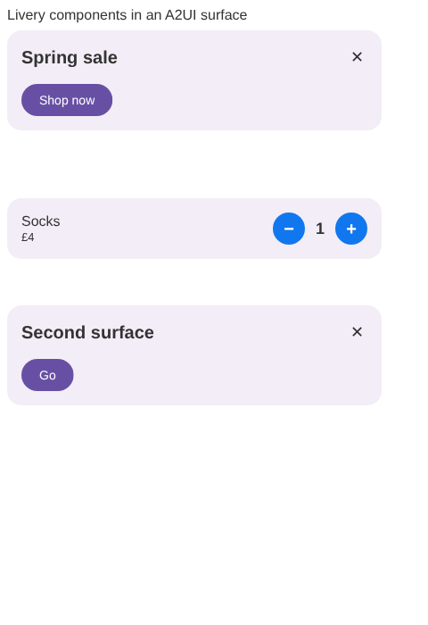

# Livery in A2UI

*Proposal, with a first prototype:* [`livery-a2ui-compose`](#the-prototype) (not yet published).
How a Livery template becomes one component of an
[A2UI](https://a2ui.org) surface, on Android, Compose Multiplatform, the web and iOS, without
Livery learning anything about A2UI and without A2UI learning anything about Remote Compose.

## The idea in one paragraph

An A2UI agent describes a screen as components from a **catalog** the client advertises; the client
draws them and reports events back. A Livery **contract** already is a component definition: typed
inputs with limits, lists, and named actions. So each contract an app serves becomes one A2UI
component, generated from the contract. The agent picks the component and supplies its inputs (as
literals or as bindings into the surface's data model) and wires its actions to A2UI events; the
client picks a signed, installed template for it exactly as a Livery slot does, binds the values
through `ContractBinder`, plays the document, and turns the document's host actions into A2UI
events. **The agent never sends Remote Compose bytes.** It chooses among reviewed designs and sends
data, which is what Livery already asks of every agent workflow ([DESIGN.md, AI
workflows](DESIGN.md#ai-workflows)).

```
agent ──updateComponents──▶ { "id": "promo", "component": "PromoBanner",
                              "headline": {"path": "/offer/title"}, "cta": "Start trial",
                              "design": "banner-classic",
                              "actions": { "cta": {"event": {"name": "startTrial"}} } }
                                   │
client: A2UI surface ─▶ PromoBanner (generated from promo/banner@1)
                          ├─ bind each property against the data model  (A2UI)
                          ├─ ContractBinder.bind(contract, dataset)      (Livery's one gate)
                          ├─ TemplateSelector: installed, signed, sized  (Livery's one gate)
                          ├─ play .rc, push values live                  (rc-players)
                          └─ host action "cta" ─▶ ActionGate ─▶ A2UI event startTrial
```

## The component is a slot, not a widget

The A2UI component never describes what the document draws. It is a **slot typed by a contract**:
the agent and the A2UI data model only ever see the contract's inputs, lists and actions, and the
document is delivered separately, through Livery, and may change at any time without the agent, the
A2UI message or the app changing.

- `live/status-tile@1` has a `level` input and a `toggle` action. One design draws `level` as a
  slider, another as a ring, next month's as two buttons; each reads the same named value and emits
  the same action. The agent binds `level` to `/lamp/brightness` once, and every design works.
- Writing back is by input too: a slider design and a stepper design both emit `set` for `level`
  (below), so the data model is updated the same way whichever control the design happens to use.
- What a document may read and emit is checked against the contract when it is published
  (`livery build --inspect`), so a new document can't need data or send actions the agent and the
  app don't already know about. A design that needs more is a new contract minor (optional
  additions) or a new major, never a surprise.

### How the document gets there

Flexible delivery, one gate. The component takes an optional `template` property; every form ends in
the same three checks before a byte is played, so where a document comes from never changes who
vouched for it:

1. **Integrity:** the bytes hash to the `sha256` they were named by (PROTOCOL.md §1).
2. **Authority:** that `sha256` is vouched for by a key the app trusts for this contract's prefix
   (§3.2 rule 6): listed in a signed manifest, or signed directly (below).
3. **Eligibility:** the template passes §5.1 for this slot (contract, `rcApiLevel`, profiles, byte
   budget, size), and its assets are verified like any template's.

| `template` | Who fetches what | Use |
| --- | --- | --- |
| absent, or `{"design", "variant"}` | the client selects from the catalogs **the app** configured (a GitHub release, a static host, a Livery server channel) | the default: designs change with the catalog, no agent or app change |
| `{"query": {…}}` | the client asks **the app's** configured Livery server for a decision, sending the contract, the device's query (size, theme, `rcApiLevel`, minor, locale) and the agent's params; the answer is a normal decision (§8) | server-side choice per request: personalisation, ads, experiments run on the server |
| `{"sha256", "url"?}` | the client fetches the blob from `url` (or its catalogs' `blobBase`), checks the hash, and plays it only if a trusted manifest lists that hash or a signature (below) covers it | the agent or its backend names one exact document; it plays exactly or not at all (§5.3) |
| `{"sha256", "url"?, "signature"}` | as above, with a **template signature**: Ed25519 over `livery-template:<contract id@major>:<sha256>` by a trusted key | a server that mints documents per request (generated, instantiated) without publishing a manifest for each |
| `{"inline": "<base64>", "signature"}` | nothing to fetch; the bytes are in the message, signed as above (PROTOCOL.md §3.4), within the app's signed limit (256 KiB by default) | documents a server or tool makes per request, signed by a key the app trusts; may use the risky features the app opts into for signed documents |
| `{"inline": "<base64>"}`, unsigned | nothing to fetch; plays only under the app's **agent-bytes policy** (off by default): its contract prefixes, at most 64 KiB, never a risky feature, no `open-url` or `present` unless the policy names it | an app whose agent is its own backend and that accepts unreviewed layout in that slot |
| `{"channel": "pr-123"}` or an unsigned form | the client's catalog source at another channel | development only, in a client that allows unsigned catalogs; never in production |

**Documents in the message** pass one gate, `DocumentAdmission` (`livery-instantiate`, PROTOCOL.md
§3.5), before anything draws: size, hash, signature or agent-bytes policy, that the document reads
and emits only what its contract declares, and its **risky features** (`shaders`, `haptics`,
`sound`, `particles`, `embedded-images`, `embedded-fonts`, `wake`), read from its operations. A
signed document may use those the app opts into (`signedFeatures`, none by default); an unsigned one
none at all, whatever the app sets, because nothing reviewed it. Either plays exactly as sent or
not at all, is never kept for another slot, and its events name it `a2ui:signed:<keyId>` or
`a2ui:unsigned`, so analytics and experiments can tell it from a reviewed design.

Two rules hold for every form:

- **The app chooses the hosts; the agent chooses only from them.** `url` must resolve to a host one
  of the app's catalog sources or its Livery server uses, and a `query` goes only to the app's
  configured server. An agent can therefore name content but never make the device contact a host
  the app didn't configure, the same rule images follow (§6.2).
- **A URL or a hash is not trust.** Anyone can host bytes and quote their hash; only a signature
  from a key the app trusts makes them playable. This is why a template signature is the one new
  piece of protocol here: it is the per-document form of the manifest signature, with the same keys
  and the same contract-prefix limits.

**Not waiting.** A slot never waits on the network (DESIGN.md), and a document the agent names may
not be on the device yet. The client starts fetching the moment the message arrives (as an
`OnDemand` design is fetched) and draws at once from what is on disk:

- a `design` or `query` answer that isn't downloaded draws the installed automatic design now
  (PROTOCOL.md §5.2) and swaps to the requested one when it arrives, if the surface still shows it;
- an exact `sha256`, signed or inline, never has another template drawn in its place (§5.3): the
  app's fallback for the contract draws now, an A2UI error tells the agent, and the document plays
  when it arrives, if the surface still shows it. (`inline` is on disk the moment it is verified.)

A2UI's loading state is used only for what A2UI itself is waiting on: a `required` input whose
binding hasn't resolved yet.

Where it is fetched from never changes what it may do: whatever the route, the document reads and
emits only what its contract declares. A document that arrived outside a built catalog (signed or
inline) is decoded on the device by `TemplateInspector` (`livery-instantiate`, multiplatform), the
check `livery build --inspect` runs, and refused if it reads or emits anything its contract doesn't.

## Why a component per contract, not one generic `RemoteCompose` component

A single `RemoteCompose { template, values: {…}, actions: {…} }` component is the obvious first
cut, and it is wrong for agents: its schema says "any object", so the agent learns nothing about
what a banner takes, and every mistake surfaces only at runtime. A component per contract puts the
contract's names, types, `maxLength`, `min`/`max`, `required` and `description`s into the catalog
schema the agent is prompted with, so the agent's own structured output is held to the contract
before the client ever sees it. The client still runs `ContractBinder` (it never trusts the
schema), but most errors never get that far.

The generic component remains useful as a **development** escape hatch, for previewing a draft
document from a preview channel by `sha256`, and only in a client that allows unsigned catalogs.

## Mapping

### Component name and catalog

| Livery | A2UI |
| --- | --- |
| contract `promo/banner@1` | component `PromoBanner`; a major above 1 adds a suffix: `promo/banner@2` is `PromoBannerV2` |
| contract `title` / `description` | component `description` |
| the contracts the app serves in-app | the components of a catalog the client advertises |
| contract minor | the optional properties the client advertises; the client advertises the minor it implements |

The component name is a deterministic projection of the contract id (path segments PascalCased and
joined), pinned by a conformance fixture so every platform generates the same schema. An app may
rename a component (a contract called `text` would collide with the basic catalog's `Text`).

A client's catalog is **the basic catalog plus the Livery components**: the AndroidX API already
composes this way (`A2uiCatalog(id, basic.components + livery, basic.functions)`), and the web
renderers register custom components beside the basic ones. Its id is the app's own URI with a
version, e.g. `https://example.com/a2ui/catalog/livery-v1`. A client advertises a component only
for a contract it has at least one usable in-app template for, so the catalog negotiation tells the
agent what this device can actually draw.

### Properties

Every contract input becomes a property; the agent may give a literal, a data-model binding
(`{"path": "/offer/title"}`) or a function call, as for any A2UI dynamic property.

| Contract | A2UI property schema |
| --- | --- |
| `string` (`maxLength`) | `DynamicString` (`maxLength` in the description and, for literals, the schema) |
| `int`, `long`, `float` (`min`, `max`) | `DynamicNumber` |
| `bool` | `DynamicBoolean` |
| `color` | `DynamicString`, pattern `#RRGGBB` / `#AARRGGBB` |
| `image` | `DynamicString`: `asset:<sha256>`, `https://…` or `app:<key>` (PROTOCOL.md §6.1) |
| list `tags` (`item`, `max`) | a dynamic value bound to an array of objects (`{"path": "/tags"}` or a literal array) |
| `required` | `required` |
| `default`, `description`, `since` | the property's description; `since` above the client's minor: not advertised |
| theme roles (`role`) | not advertised: filled from the surface theme (below) |

Plus three static properties every Livery component has:

| Property | Meaning |
| --- | --- |
| `design` | a design id to prefer; missing or unavailable falls back to automatic selection (PROTOCOL.md §5.2) |
| `variant` | a variant to prefer (`compact`, `hero`) |
| `actions` | an object, one A2UI `Action` per contract action name: `{"cta": {"event": {...}}}` |

Actions are grouped under `actions` because a contract may name an input and an action alike
(`promo/banner` has both a `cta` input and a `cta` action).

### Values: binding, and the one gate

On every recomposition the component binds each property against the surface's data model (A2UI's
`bind`), assembles the results into one dataset JSON object, and hands it to
`ContractBinder.bind(contract, dataset)`. The resulting `Bindings` are pushed into the playing
document as named values, exactly as `LiveryTemplate` does today, so a data-model update animates
in place and the first frame already shows current data.

- A property still pending (A2UI's progressive rendering) keeps the component in A2UI's loading
  state (`isReady` is false until every `required` input has resolved).
- A dataset that doesn't bind is **reported to the agent** with A2UI's `reportError`, naming the
  problems `ContractBinder` gives, so the agent can correct itself; the component draws its
  fallback (below).
- An `image` value that is `https://…` is fetched only through the catalog's image proxy or the
  app's allowlist (PROTOCOL.md §6.2), exactly as in a slot. A2UI's own `Image` component is the
  host's concern and is not affected.

### Theme

A theme role input (`"role": "primary"`) isn't one of the component's properties, so the agent
doesn't set it per component. It is filled, in order, from the surface theme the agent sent in
`createSurface` (`primaryColor` → `primary`), then from the host's colours. So a Livery component
matches the A2UI components around it without the agent saying anything, and takes the agent's
brand colour when the agent gives one. *Built* on the web; A2UI's Compose runtime doesn't give a
component its surface's theme, so on Compose the roles come from the host's Material colours.

### Choosing and drawing the template

The component is a Livery slot whose decision comes from the agent:

1. Query: the contract, `in-app` surface, the space A2UI's layout gives the component (width and
   height in dp), the `design` and `variant` properties, the host theme, the minor the app
   implements.
2. `TemplateSelector` picks among installed, verified templates, from disk only. Rendering never
   waits on the network.
3. A requested design that isn't available falls back to the automatic choice, never to nothing.
   If the contract has no playable template at all (it was advertised, then revoked), the
   component reports an A2UI error and draws the app's native fallback for that contract, or an
   empty box of the requested size.

With a `template` other than a design preference, the steps above apply to the document it names
instead of to the catalog's choice (see [How the document gets there](#how-the-document-gets-there)).

### Actions, events and analytics

When the document emits a host action, the component first passes it through `ActionGate` (it must
be declared by the contract, with its declared arguments of their types), then:

| `actions.<name>` from the agent | What happens |
| --- | --- |
| `{"event": {"name", "context"}}` | an A2UI event to the agent: `name`, the agent's `context` (resolved by A2UI) **plus the action's declared arguments** under their own names. A context key that shadows a declared argument is refused when the component is built |
| `{"functionCall": …}` | run by the A2UI client (e.g. `openUrl`, which then obeys the A2UI host's own rules) |
| not given | the app's Livery `ActionRouter`, as in any slot: `navigate`, `open-url` (allowlisted), `dismiss`, `track`, `app:*` |

So the agent wires only what it cares about, and a design's `dismiss` or `track` works with no
agent wiring at all. Every action, wired or not, is an `Action` event on the app's `EventSink`, with
`Impression`, `Viewable` and `Leave` as for any template; the event's `decisionId` is
`a2ui:<surfaceId>/<componentId>`, so analytics can tell agent-placed templates from the app's own
(`RenderPlan.decisionId`; *built* on the web, where A2UI gives the component both ids. A2UI's
Compose runtime keeps them private to `A2uiComponentScopeImpl`, so on Compose the event has none
yet).

### Writing back: two-way binding

A2UI lets an input component write the data model at a property's path (`bindUpdater`). A template
that changes one of its own inputs (a toggle, a stepper) needs the same, and so does an app that
plays a template live outside A2UI. So it is Livery protocol, not an A2UI special case: the `set`
action kind (PROTOCOL.md §7.1, protocol level 7).

- **Protocol:** a `set` names the contract input it changes (`input`) and carries one argument,
  `value`, checked as that input is (type, `min`/`max`, `maxLength`; a bool also takes the `1`/`0`
  a document's boolean sends). The document computes `value` when tapped (`quantity + 1`), so it
  keeps no state of its own. The publisher refuses a `set` without a scalar input of its own
  contract, and a catalog with one needs level 7. Kotlin and Swift agree through
  `conformance/actions.json`.
- **In A2UI:** the component writes a `set`'s value through the updater of the property bound to
  that input, A2UI's own `bindUpdater`. The data model changes, the property re-binds, and the new
  value is pushed back into the document, so the document and the model can't disagree; anything
  else in the surface bound to the same path (a `Button`'s event context) sees it too. When the
  agent wired the action as well, its event follows the write, with `value`. When the agent gave a
  literal, there is nowhere to write: the agent gets an A2UI error and nothing changes, as A2UI's
  own inputs go read-only. A value past the input's limits is refused before anything is written.
- **Outside A2UI:** an app registers a `set` handler that updates its own model, and the live push
  does the rest.
- **Authoring:** `livery-capture`'s `LiveryValues.set(name, value)` sends one, checked against the
  input's type at capture.

### What an app can do that an agent can't

The app owns the surface. `LiveryA2ui.decision(placement)` can pre-populate a Livery component in a
surface from a Livery decision (a promotion inside an agent's answer, for instance): the template
is the decision's, `sha256`-exact, and the agent sees it as a component it may move but not
re-skin. This keeps PROTOCOL.md §5.3: a decision draws only in the template it names.

## Libraries

All optional modules: nothing in `livery-protocol` or `livery-client` changes except the `set`
action kind.

| Module | Platforms | Does |
| --- | --- | --- |
| `livery-a2ui` *(built)* | KMP (JVM, Android, iOS, Wasm), no Compose | **Produces.** *Built:* `LiveryA2ui.component(contract)` (name, properties, `schema()`), `catalogSchema(catalogId, contracts)`, `dataset`, `themeValues`, `writable`, `eventPayload`, pinned by `conformance/a2ui.json`; `ProjectionMatchesA2uiTest` holds A2UI's own advertised schema to it. *Built:* `LiveryA2uiMessages.validate` (an agent's messages against the contracts: properties, actions, `template`, `design`, and values through `ContractBinder`, bindings too given the data model) and the `LiveryA2ui.componentJson(id, contract) { … }` builder. The projection: contract → A2UI component definition (JSON Schema), a whole Livery catalog → an A2UI catalog JSON; the dataset assembly from resolved properties; event mapping. The same code the clients run |
| `livery-a2ui-compose` | Android (AndroidX `androidx.a2ui`), desktop and Wasm (`ee.schimke.a2uicmp` port) | **Renders.** `LiveryA2uiComponents(host, contracts)`: one `A2uiComponent` per contract over `LiveryTemplate`; `liveryA2uiCatalog(basic, host)` to combine with the Material basic catalog |
| `livery publish` | CLI | writes `a2ui-catalog.json` beside `manifest.json`, so an agent in any language (A2UI's agent SDKs are Python and TypeScript) is prompted with the same schema the clients advertise |
| `livery-mcp` *(built)* | any MCP host (`livery-mcp-core`) | `a2ui_component_schema(contract?)` and `validate_a2ui(message, data_model?)`, for an agent authoring an A2UI response against a catalog |
| `livery-web` *(built)* | Wasm (browsers, Node), and the JVM for its tests | **The pipeline, for the web.** `LiveryA2uiWeb`: the playable components, `render` (catalog selection or the agent's admitted document, `ContractBinder`, then `TemplateInstantiator` writes the values in), and `action` (`ActionGate`, then the agent, a `set`, or the page's handler), exported to JavaScript as a small JSON API. `WebCrypto` in `livery-client` verifies signatures and blobs |
| `@livery/a2ui` *(built, `web/a2ui`)* | browsers | **Renders on the web.** `liveryCatalog(session, {catalogId})`: A2UI's basic catalog plus one component per contract for Lit, React or Angular, its Zod schema from A2UI's own dynamic types, drawing in the page with the TypeScript Remote Compose player and setting named values live |
| Swift `LiveryA2UI` | iOS, macOS | the same component over `LiveryTemplateView`, for A2UI's SwiftUI renderer once it is published |

### One source, two A2UI artifacts on Compose

`androidx.a2ui:*` is Android-only, and the Compose Multiplatform port (`ee.schimke.a2uicmp:*`, from
[yschimke/a2ui-catalog](https://github.com/yschimke/a2ui-catalog)) keeps upstream's packages and
covers JVM and Wasm. So `livery-a2ui-compose` compiles one source directory twice: in `androidMain`
against the AndroidX AARs (an Android app keeps the real library) and in `skikoMain` against the
port. Neither is a common dependency, so the directory is added to both source sets rather than
being `commonMain`. iOS waits for the port to add Apple targets (its seam needs `Locale`,
`DateFormat` and `NumberFormat` there); the Swift path above is the alternative.

The A2UI release train is alpha and moves in lockstep; `livery-a2ui-compose` pins one release and
moves with it, as a2ui-catalog does.

### The web

*Built*: [`web/a2ui`](../web/a2ui) (`@livery/a2ui`) over [`livery-web`](../livery-web), checked in
headless Chromium by CI (`web` job).

 There is no TypeScript port: the web runs Kotlin's own
selection, trust, binding, instantiation and action gate, compiled to Wasm, so it can't drift from
the other clients and needs no fixture of its own beyond the ones Kotlin already passes.

- **Drawing.** The TypeScript Remote Compose player (vendored from rc-players, `web/a2ui/vendor`)
  on a canvas in the component itself: no iframe. A document is loaded once and its named values
  are set on it while it plays (`createHostApi`), so a data-model change moves values and never
  reloads the document, as `LiveryTemplate` does on Compose. Only what that player can't set live
  is written into the document (`TemplateInstantiator`): bound images (`livery:value/<input>`) and
  `long` values; a change to one of those is a new document.
- **Each player implements the Remote Compose spec.** No player defines it, AndroidX's included:
  that one is a useful reference to compare against, and it can be wrong too. Two places where the
  TypeScript player didn't follow the spec are fixed in rc-players' copy of it
  ([yschimke/rc-players#829](https://github.com/yschimke/rc-players/pull/829), merged; vendored
  from its `main`). First, a layout's spacing and a corner radius may be a variable reference, which Compose
  writes for dp over the density. The player read it as a plain float (`NaN`), so templates had no
  surfaces and no touch areas. Second, it skipped the definitions inside a click, so a button whose
  action name another click defined fired nothing until that one was tapped. The browser test taps
  the drawn buttons.
- **The component.** One `A2uiLitElement` per contract, registered with
  `basicCatalog.derive({catalogId, components: [...basic, ...livery]})`. Inputs and lists come
  resolved from A2UI's controller; `actions`, `template` and a `set` input's `{"path"}` binding are
  read as the agent wrote them. A `set` writes through `dataContext.set(path, value)`; an agent's
  action goes out through `dispatchAction` with the template's checked arguments in its context.
- **Documents named by hash.** `template: {"sha256", "url"?, "signature"?}` plays exactly that
  document or the page's fallback: from a trusted catalog that lists it, else fetched from `url`
  (a host the catalog uses) and admitted with its signature by `DocumentAdmission`. A document not
  on the device yet answers *waiting* like an image, and the same `fetchImages` fetches it.
- **Images.** Rendering never waits on the network: a render uses only images already on the
  device, and one that misses answers *waiting*; the element fetches them (`fetchImages`, off the
  render path) and renders again, as widget hosts do with `CachedImages`. One fetch serves every
  component waiting in the session. If an image can't be fetched, the component can't draw.
- **When it can't draw.** The agent hears why (`onProblem`). A chosen design that can't load, or
  whose image can't be fetched, falls back to the automatic choice, never to nothing. The agent's
  own `template` document is never replaced, so it, and an automatic choice that can't draw either,
  show the page's `fallback`.
- **Events.** Every event of a component carries `decisionId` `a2ui:<surfaceId>/<componentId>`,
  from `componentModel.id` and `dataContext.surface.id`; the page reads them with
  `session.events()`.
- **Theme.** `primary` from the surface's `createSurface` theme (`primaryColor`) when the agent
  sent one; each role (`primary`, `surface`, `onSurface`, …) otherwise from `--livery-<role>`, else
  A2UI's own `--a2ui-color-<role>`, else Material 3's baseline, so a template matches the basic
  components beside it.
- **Size.** The width the element gets selects the design (and redraws on a resize). The height
  is the page's `--livery-a2ui-height` when it sets one (which selection then also uses), else the
  template's own height (the height rule below).

A2UI's web renderers share `@a2ui/web_core` (`MessageProcessor`, `Catalog`, `DataContext`). A
custom component is an API object (a name, a tag and a Zod schema) plus an implementation per
renderer: a subclass of `A2uiLitElement` in `@a2ui/lit` (built), `createComponentImplementation(Api,
…)` in `@a2ui/react` and a `CatalogComponent` in `@a2ui/angular` (all built over a shared renderer-neutral
controller and the same session).

On the wire, a client action is `{name, surfaceId, sourceComponentId, timestamp, context}`, so a
Livery action arrives at the agent with `sourceComponentId` naming the Livery component and the
action's declared arguments inside `context`.

### Apple and Flutter

A2UI's own SwiftUI renderer (`A2UISwiftUI`) and Flutter renderer (`a2ui_flutter`) exist in the A2UI
repository but are not published yet. Once the SwiftUI one is, `LiveryA2UI` is the same projection
in Swift over `LiveryTemplateView` and rc-players' native player. Flutter has no Remote Compose
player, so it is out of scope.

## Conformance

A new fixture, `conformance/a2ui.json`: contracts and the A2UI component definitions they project
to (names, schemas), resolved property sets and the dataset or problems they give, and emitted
actions with an agent's `actions` and the A2UI event (or Livery route, or refusal) each produces.
Kotlin writes it; the TypeScript and Swift adapters must reproduce it.

## The prototype

[`livery-a2ui-compose`](../livery-a2ui-compose) is the component on Compose, compiled from one source
directory (`src/a2ui`) twice: for Android against the AndroidX AARs, and for the JVM and the browser
(Wasm) against the port, through one `portMain` source set. Its tests run the sample catalog in a
real A2UI surface on the desktop: JSON messages applied by A2UI's engine, basic-catalog components
beside generated Livery ones, templates selected from the catalog `livery-publish` builds, offline,
and played by rc-players.

`PromoBannerA2uiTest` (`promo/banner@1`, a `PromoBanner`) checks that:

- the catalog the client advertises has `PromoBanner`, with the contract's limits and defaults in
  its schema and without the theme roles;
- the banner draws with data bound from the data model, in the host's colours;
- an `updateDataModel` redraws the playing document without restarting it (one `Impression`);
- a design the device doesn't have falls back to the automatic one;
- data the contract refuses (a 41-character headline) is reported to the agent as an A2UI error,
  and nothing else draws;
- tapping the template's CTA sends the agent's `startTrial` event, from component `promo`, with
  the agent's context and the template's `route`, and Livery's own `Action` event.

`PollA2uiTest` (`social/poll@1`, a `SocialPoll`) is the loop an agent runs, with data that keeps
changing. The agent binds the poll to `/poll` once (`question`, `summary`, and `options`, a list of
`label`, `share`, `result` and `mark`) and wires `vote`:

1. A tap on "Swift" is the template's `vote` with `option: "1"`; it reaches the agent as its `vote`
   event, from component `poll`, with `option` and the agent's own `poll` context.
2. The agent counts it and answers with `updateDataModel`: new shares and results, `✓` on Swift,
   "129 votes · you voted". The same document redraws.
3. Other people's votes keep arriving as more `updateDataModel`s, and keep redrawing it.
4. Through all of it there is one `Impression`: the document is kept and only its values change.

It also checks that a `vote` the agent didn't wire goes to the app's `app:vote` handler instead,
and that the document draws as many option rows as the data has (`options.count`, up to the
contract's 4), so the same document serves a two-option and a four-option poll.

`QuantityA2uiTest` (`shop/quantity@1` from `samples/two-way`, a `ShopQuantity`) is two-way
binding. The agent binds `quantity` to `/cart/qty`; the template's `+` and `−` are `set`s of
`quantity`, and each tap writes `/cart/qty` through A2UI's updater, so an A2UI `Button` beside it
reads the new quantity into its `checkout` event. It also checks that the next step starts from a
quantity the agent sent, that a step past the contract's max of 9 is refused and writes nothing,
and that a literal `quantity` (nowhere to write) is reported to the agent.

The poll's document is a real one, captured from Compose by `livery-capture`'s `SamplePollTest`:
every row is the same composable reading `options.<i>.*`, its bar is `fillMaxWidth(share)`, and it
is gone when `options.count` is at most `i`. The data does the formatting (`result`, `summary`,
`mark`), so the agent decides what the results say and the design decides how they look.

`samples/catalog/designs/banner-classic/in-app.rc` was a placeholder, so it is now captured from
Compose by `livery-capture`'s `SampleBannerTest` (regenerate with
`-Plivery.capture.write=true`). `banner-bold` stays a placeholder: it reads a data-bound image,
which `LiveryValues` can't capture yet.

What the prototype taught, and what it doesn't do yet:

- **The A2UI pin.** The port is `1.0.0-alpha01`, so the Android side pins the AndroidX
  `1.0.0-alpha01` AARs too: `alpha02` changed `materialA2uiBasicCatalogV1` (one `Functions` in
  place of `urlOpener`, `messageFormatter`, `localeProvider`). The component itself only uses
  `A2uiComponent`, `A2uiCatalog` and the property API.
- **Compose and Java.** A2UI pulls the Compose 1.13 alphas, ahead of the stable 1.12 line the core
  builds on, and the published port is Java 21 bytecode: both costs land on this optional module
  only.
- **Semantics come through.** The player's text is in Compose semantics, so a UI test taps the CTA
  by its label inside the A2UI surface.
- **Not yet:** the projection lives in the Compose module rather than `livery-a2ui`; no
  conformance fixture; events carry no `a2ui:<surface>/<component>` decision id (A2UI's `A2uiComponentScope` exposes
  neither id; the web has it); the
  `createSurface` theme isn't read (theme roles come from the host's Material colours; the web
  reads it); no
  `template` forms other than the design preference, or the height rule (the web has it).

## Order of work

1. `livery-a2ui`: projection, dataset assembly, event mapping, `conformance/a2ui.json`;
   `livery build --a2ui <catalogId>` writes `a2ui-catalog.json`. *Done* (below). The Kotlin
   builder for agents and the message validator (with the MCP tools) are *done* too.
2. `livery-a2ui-compose` on Android against the AndroidX AARs and on the JVM against the port, with
   the sample catalog's `promo/banner` inside an A2UI surface. *Prototyped* (above).
3. Wasm against the port (*compiles*; not yet run in a browser), and moving to the AndroidX
   release the port next follows.
4. The `set` action kind (protocol level 7, Kotlin, Swift, fixtures), and two-way binding in A2UI.
   *Done* (above, and `QuantityA2uiTest`).
5. Documents named by the message. *Done for `inline`*: template signatures (PROTOCOL.md §3.4,
   `livery sign-template`, Kotlin and Swift, `conformance/template-signing.json`), and
   `DocumentAdmission` with risky features and the agent-bytes policy (§3.5, `InlineDocumentsA2uiTest`).
   Catalog templates are held to the same features (*done*, protocol level 8): the publisher
   records each template's `features`, and selection skips one the player's
   `PlayerCapabilities.features` doesn't allow, so the A2UI component's catalog path and its
   inline path agree. `sha256` (+ `url`, + `signature`) is *done on the web*: a hash a trusted
   catalog lists plays from that catalog's blobs; any other needs a template signature and comes
   from `url`, on a host the app's catalog uses; neither is downloaded on the render path. Still to
   do: that form on Compose, and the `query` form, which needs a decision API that takes the
   contract and the agent's params (the app's `Decider` takes only a placement) and a server to
   answer it.
6. `@livery/a2ui`. *Done* without a TypeScript port: `livery-web` (Kotlin, compiled to Wasm) and
   Lit, React and Angular components per contract, drawing with the TypeScript player and live
   named values. IndexedDB caching and Binaryen optimization are built. npm release automation
   is prepared; publishing needs the owner's token.

## Open questions

- **Catalog identity.** A2UI's `catalogId` is an identifier, not a URL anyone fetches, and the
  set of components depends on what the device has installed, so two devices may advertise the
  same id with different components. Either the id carries a digest of the contract set, or
  (simpler) the client sends the catalog in `a2uiClientCapabilities.inlineCatalogs` when it differs
  from the published `a2ui-catalog.json`.
- **Lists of components versus lists in a template.** A feed can be an A2UI `List` of Livery
  components (one template per item, as Livery feeds do) or one template with a list input. The
  first is better for viewability per item; worth a sample of each.
- **Size.** A page's `--livery-a2ui-height` wins. Otherwise the web controller uses the player's
  measured root content height at the current width, at least the target's `minHeightDp`.
  `Rendered.Ready.heightDp` supplies the authored fallback when no finite root measurement is
  available; `minHeightDp` keeps an explicit target minimum distinct from that fallback.
  Measurement uses the destination bounds of layout animations, so a transient frame cannot
  clip the final card. The sample banner is 112dp high rather than its 160dp authored viewport.

### npm releases

`@livery/a2ui` follows the repository version. Release-please updates its package and lockfile;
merging the release PR builds and checks the npm tarball, then publishes it alongside Maven.
The repository owner must configure `NPM_TOKEN` with publish access to `@livery/a2ui` before the
first npm release. No npm release has been made yet. `npm run pack:check` checks the files and
relative runtime imports in the actual tarball in CI. The TypeScript player remains vendored
with its provenance until rc-players publishes a supported npm package.

### React and Angular

The same session and controller power all three web renderers. Use
`liveryReactCatalog(session, options)` from `@livery/a2ui/react` with React's `A2uiSurface`, or
`liveryAngularCatalog(session, options)` from `@livery/a2ui/angular` with Angular's
`provideA2Ui({ catalogs: [catalog] })` and `SurfaceComponent`. Install the matching optional peers:
React 18/19 with `@a2ui/react` 0.15; Angular 21 with `@a2ui/angular` 0.14 (which uses web_core 0.15).
Angular applications also configure A2UI's `provideMarkdownRenderer()` for the basic components.
The Angular entry ships partial compilation for the application's Angular linker.

`options.base` extends the selected renderer's catalog. Actions, data-model paths, themes,
decision ids, retry and height behavior are shared. `fallback` returns a Lit template for Lit,
a React node for React, or a DOM node/string for Angular. `npm test` runs the same sample catalog
and all interaction checks once per renderer; `CHROMIUM_PATH` can select a local Chromium binary.

### Persistent browser cache

Web sessions default to IndexedDB for blobs and small named documents. A session with playable cached templates reads
its catalog immediately and refreshes in the background. A cached manifest without playable
blobs first retries prefetch, so an interrupted download cannot register an empty component catalog.
Template rendering does not
wait for a network response. The existing repository still owns expiry, stale grace, install
policy, blob eviction and image-cache metadata. Browser storage can be cleared or evicted by
the browser; this is a cache, not durable application data.

Set `persistentCache: false` in `LiverySession.open` for memory-only sessions (also useful in
hosts that deny IndexedDB). Cache namespaces include the catalog and trust configuration:
switching from an unsigned development catalog to signed trust cannot reuse the old manifest.
The browser suite reloads with all catalog requests blocked and checks that cached templates
draw, that memory-only sessions cannot use this cache offline, and that a different trust configuration
cannot inherit the cached unsigned catalog. Serving an application's shell offline remains the
host application's responsibility.

### Wasm distribution size

`webDist` runs Kotlin's pinned Binaryen optimizer before packaging. On the 0.6.0 baseline this
reduces raw Wasm from 4,749,595 to 1,454,082 bytes (69.4%). Ktor remains in the module to preserve
its fetch and redirect contract. `docs/WASM-SIZE.md` records section and dependency measurements;
`scripts/wasm-size.py` reproduces the breakdown for subsequent builds.
